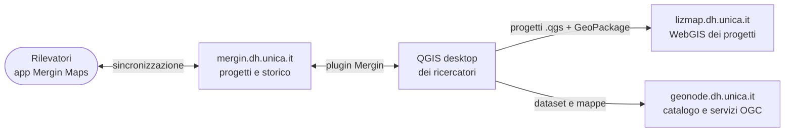
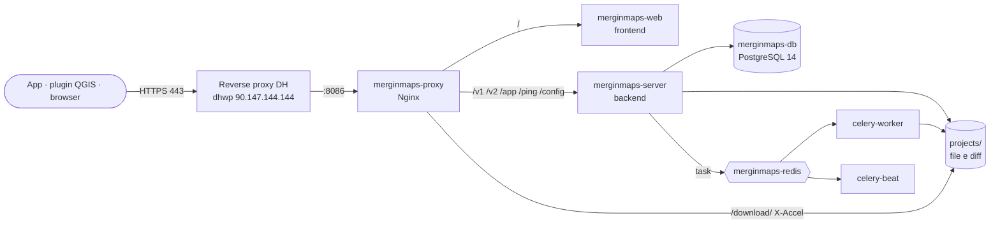

<div align="center">

# 📍 Mergin Maps DH UNICA

**Il server per i rilievi sul campo del Centro Interdipartimentale per l'Umanistica Digitale dell'Università di Cagliari**

[](https://mergin.dh.unica.it/)
[](https://merginmaps.com/)
[](https://www.postgresql.org/)
[](docker-compose.yml)
[](https://dh.unica.it/)

</div>

---

## Cos'è

**[mergin.dh.unica.it](https://mergin.dh.unica.it/)** è il server [Mergin Maps](https://merginmaps.com/) del Centro. I gruppi di ricerca lo usano per raccogliere dati sul campo: preparano un progetto in QGIS, lo caricano sul server e i rilevatori lo compilano dal telefono con l'app Mergin Maps, anche senza rete. Al rientro l'app sincronizza le modifiche e il server tiene lo storico di ogni versione, con le differenze campo per campo sui GeoPackage.

Gira la **Community Edition**, open source, sulla stessa VM del [WebGIS Lizmap](https://github.com/Dh-unica/lizmap.dh.unica.it).

I primi progetti ospitati sono quelli del gruppo **PARC** (*Prosopography of Africa's Roman Cities*), con referente Antonio M. Corda. Fino a ottobre 2026 erano su `mergin.webparc.it`, gestito da Faunalia; da novembre 2026 sono sui server del Centro (vedi [docs/MIGRAZIONE.md](docs/MIGRAZIONE.md)).

Questo repository contiene **la configurazione di produzione** e gli strumenti per ripristinarla, verificarla e salvarla. Database e progetti stanno solo sul server e nei backup.

### Come ci si collega

| Strumento | Impostazione |
|---|---|
| App **Mergin Maps** (Android, iOS) | al login, *Server personalizzato* → `https://mergin.dh.unica.it` |
| Plugin **Mergin Maps** di QGIS | *Impostazioni* → *Use custom server* → `https://mergin.dh.unica.it` |
| Browser | [https://mergin.dh.unica.it](https://mergin.dh.unica.it/) |

Non c'è registrazione libera: gli account li crea l'amministratore. Chi usava `mergin.webparc.it` deve cambiare l'indirizzo del server nell'app e nel plugin.

---

## Parte dell'ecosistema DH UNICA

[DH UNICA](https://dh.unica.it/) è il **Centro Interdipartimentale per l'Umanistica Digitale** dell'Università di Cagliari. Per i dati spaziali usa tre strumenti complementari:



- **Mergin Maps** raccoglie i dati sul campo e ne conserva le versioni;
- **[Lizmap](https://github.com/Dh-unica/lizmap.dh.unica.it)** pubblica i progetti QGIS sul web;
- **[GeoNode](https://github.com/Dh-unica/geonode.dh.unica.it)** cataloga e distribuisce i dataset con metadati standard.

Mergin e Lizmap non si sincronizzano tra loro: i dati passano dal QGIS dei ricercatori.

---

## 🧰 Stack tecnologico

| Componente | Immagine / versione | Ruolo |
|---|---|---|
| **Backend** (Flask + Gunicorn) | `lutraconsulting/merginmaps-backend:2025.7.3` | API usate da app, plugin e interfaccia web; sincronizzazione e storico |
| **Celery beat e worker** | stessa immagine del backend | Attività pianificate e asincrone: archivi zip, pulizie, statistiche |
| **Frontend** | `lutraconsulting/merginmaps-frontend:2025.7.3` | Interfaccia web di amministrazione e consultazione |
| **PostgreSQL** | `postgres:14` | Utenti, progetti, versioni, permessi |
| **Redis** | `redis:6.2.17` | Coda dei messaggi per Celery |
| **Nginx** | `nginxinc/nginx-unprivileged:1.27` | Punto d'ingresso: smista tra frontend e backend e serve i file dei progetti (X-Accel) |

---

## 🏗️ Architettura



Lo stack gira su **dhgeo** (`90.147.144.148`), la VM GIS del Centro, insieme a Lizmap. Il TLS si ferma sul reverse proxy comune [`proxy.dh.unica`](https://github.com/caprowsky/proxy.dh.unica), con il certificato wildcard `*.dh.unica.it`. La porta 8086 di dhgeo accetta connessioni solo dal proxy e dalla VPN d'ateneo.

I container girano con uid e gid fissi: PostgreSQL come `999`, backend e worker come `901:999`, frontend e Nginx come `101:999`. La cartella `projects/` appartiene a `901:999` con permessi `2750`, e il gruppo 999 è quello che permette a Nginx di servire i file.

---

## 📁 Struttura del repository

```text
mergin.dh.unica.it/
├── README.md                 ← questo file
├── CLAUDE.md                 ← istruzioni e regole per le sessioni di Claude Code
├── PROSSIMI-PASSI.md         ← stato attuale e attività da fare, aggiornato a ogni intervento
├── docker-compose.yml        ← definizione dei servizi
├── nginx.conf                ← configurazione del proxy interno (da MerginMaps/server)
├── otel.env                  ← telemetria OpenTelemetry (disattivata)
├── .prod.env.example         ← configurazione dell'applicazione con i segreti oscurati
├── .env.example              ← password del DB e porta pubblicata (copiare in .env)
├── docs/
│   └── MIGRAZIONE.md         ← migrazione dal server Faunalia a dhgeo: problemi trovati, procedura, verifiche
├── scripts/
│   ├── ripristina-export.sh  ← ripristino di database e progetti dall'export Faunalia
│   ├── verifica-db.sh        ← primo avvio del database, controllo del recovery e dump completo
│   ├── smoke-test.sh         ← controlli rapidi dello stack (solo letture)
│   └── backup.sh             ← dump del database e istantanee incrementali dei progetti
└── .githooks/pre-commit      ← blocca i commit su main e l'ingresso di segreti o dati
```

Sul server, accanto ai file versionati, ci sono le cartelle escluse da git: `mergin_db/` (dati di PostgreSQL), `projects/` (file dei progetti, diff e archivi), `diagnostic_logs/`, `backup/`, e i file `.prod.env` e `.env`.

---

## ⚙️ Configurazione

La configurazione dell'applicazione sta in `.prod.env`, che **non è versionato**. [`.prod.env.example`](.prod.env.example) ne è la copia fedele, con password, chiavi e salt sostituiti da `<REDACTED>`.

| Variabile | Valore in produzione | Nota |
|---|---|---|
| `MERGIN_BASE_URL` | `mergin.dh.unica.it` | indirizzo pubblico, usato nei link |
| `CONTACT_EMAIL` | `dh@unica.it` | contatto dell'amministratore |
| `GLOBAL_STORAGE` | `32212254720` | quota del workspace: 30 GiB |
| `USER_SELF_REGISTRATION` | `False` | gli account li crea l'amministratore |
| `MAIL_SUPPRESS_SEND` | `1` | nessuna mail in uscita: le password le reimposta l'amministratore |
| `SECURITY_PASSWORD_SALT` | segreto | ⚠️ **non va mai cambiato**: invaliderebbe le password di tutti gli utenti |

`.env` contiene `POSTGRES_PASSWORD`, uguale a `DB_PASSWORD` di `.prod.env`, e `MERGIN_PORT`, la porta pubblicata sull'host.

---

## 🚀 Gestione in produzione

Lo stack gira in `/home/dhgeo/mergin.dh.unica.it` su dhgeo, con Docker Compose v2.

```bash
ssh -o IdentitiesOnly=yes -i ~/.ssh/id_rsa dhgeo@90.147.144.148
cd ~/mergin.dh.unica.it
docker compose ps                          # stato dei servizi
docker compose logs -f --tail=100 server celery-worker
scripts/smoke-test.sh                      # controlli rapidi
scripts/backup.sh                          # dump e istantanea dei progetti in ./backup
docker exec -it merginmaps-server flask --help   # comandi di amministrazione
```

> [!WARNING]
> Da **non** usare mai: `docker compose down -v`, `docker system prune`, `rm` su `mergin_db/` o `projects/`, `flask init-db` (serve solo per un'installazione vuota), estrazioni di archivi senza `tar --numeric-owner`. Non cambiare i tag delle immagini senza un piano di aggiornamento: lo schema del database deve seguire la versione del backend.

---

## 🤝 Come contribuire

- **Mai commit diretti su `main`**: `main` rispecchia ciò che gira in produzione.
- Un branch per attività, creato da `main` aggiornato, con prefisso convenzionale: `feat/`, `fix/`, `docs/`, `chore/`, `refactor/`.
- Messaggi di commit **in italiano** con tipo convenzionale, per esempio `fix: limita la dimensione dei log dei container`.
- Ogni branch si chiude con una Pull Request; dopo il merge il branch si cancella (impostazione automatica del repository).
- I rilasci in produzione hanno un tag `prod-<data>`, per esempio `prod-2026-11-02`.
- Dopo il clone, attivare i controlli locali: `git config core.hooksPath .githooks`. L'hook blocca i commit su `main` e l'ingresso di `.env`, `.prod.env`, dump e archivi.
- Sul server il repository si aggiorna solo con `git pull` da `main`: lì non si fanno commit.

---

<div align="center">
<sub>
<a href="https://dh.unica.it/">DH UNICA</a>, Centro Interdipartimentale per l'Umanistica Digitale · Università degli Studi di Cagliari<br/>
Basato su <a href="https://merginmaps.com/">Mergin Maps</a> Community Edition di Lutra Consulting, software open source (AGPL-3.0)
</sub>
</div>
